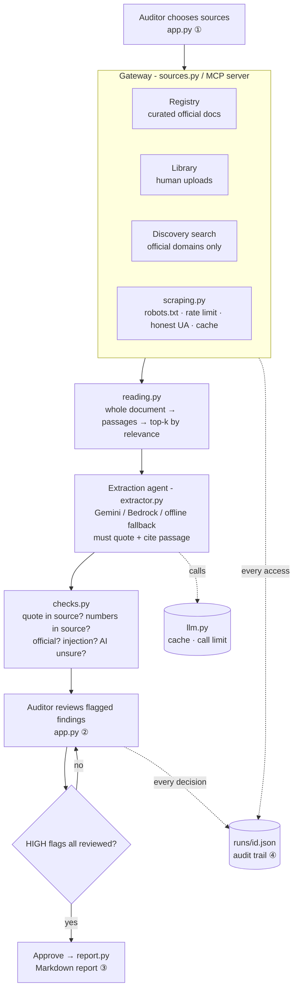

# Design: Liability Radar (v1 prototype)

## 1. Overview
A **controlled agentic pipeline**. Fixed code runs the steps in order; the AI agent is autonomous
only inside the extraction step; humans decide at both ends (which sources go in, and which findings
come out). All external information enters through one **gateway** (`sources.py`), which is also
published as an **MCP server** (`sources_server.py`).

## 2. Components

| Component | Responsibility | Network access? | Requirements |
|---|---|---|---|
| `app.py` | Source selection, review, approval, audit views | No | 1, 10, 11.2, 14.2, 16 |
| `pipeline.py` | Fixed step order, run record, approval gate, coverage | No | 9, 10, 11, 12 |
| `sources.py` (gateway) | Registry, library, discovery, get_document | Only via `scraping.py` | 6, 16 |
| `scraping.py` | Responsible fetching | **Yes, the only module** | 7 |
| `reading.py` | Passages, relevance ranking, injection signals | No | 2, 13, 16.4 |
| `extractor.py` | AI extraction with strict rules; offline fallback | No (AI via `llm.py`) | 2, 3, 5, 14 |
| `checks.py` | Code-based verification → flags | No | 8 |
| `report.py` | Report assembled by code from reviewed findings | No | 4, 9, 10.4 |
| `llm.py` | Provider switch, cache, call limit | AI API only | 12 |
| `sources_server.py` | Gateway as MCP server (read-only tools) | Via gateway | 6 |

## 3. Data model (`models.py`)
`RawFinding` (what the AI must return: passage_id, quote, statement, category, effective_date,
status, confidence) → `Finding` (+ jurisdiction, section, source, tier, page, passage_text,
method, flags, review). The run record (JSON) holds: inputs, AI provider/model/calls,
access_log, documents with kept passages, notes, findings, coverage, review_history, approval.

## 4. Design decisions and justifications

**D1. Fixed pipeline with an agent inside a step, not a free-roaming agent (yet).**
Alternative: one agent with search tools deciding everything (`learning/step1_agent_loop.py`).
Why: predictable, comparable and auditable runs; MAS expects autonomy "within preset, safe
boundaries". Trade-off: less flexible discovery. The free-roaming version reuses the same
gateway and is the planned v2 (Experiment E1).

**D2. A curated registry plus a human library, not search alone.** *(answers "where do we find the policies?")*
Why: key rules (often deep PDFs) are missed or mis-ranked by search; bank-internal policies are
never public. Search is kept for discovery, but results enter only when a human ticks them.

**D3. One gateway, published as MCP.**
Why: source discipline in one inspectable place; agents have no network code; any MCP client
(Kiro, Claude Desktop, future agents) gets the same controls; in production DBS could swap in a
licensed-data MCP server without changing the agents.

**D4. Responsible scraping by design** (`docs/responsible_scraping.md`).
robots.txt (RFC 9309, cautious on failure), honest User-Agent, ≥3 s per site, no circumvention,
cache as evidence, quotes not copies. Explicitly rejected: spoofing a browser to avoid blocks.

**D5. Read whole documents, then rank passages.**
Alternative: truncate to the first pages (the earlier prototype read 5 pages / 3,000 characters).
Why: the SRF's loss-allocation rules are on pages 8–14. Ranking keeps cost low while making
every finding cite an exact passage and page.

**D6. Structured, validated AI output.** Pydantic rejects malformed findings, so they never
reach a reviewer silently. Each finding has an ID for review and audit.

**D7. Verification in code, not AI self-grading.** Quote match (exact/approximate), number
match, tier, injection and staleness are deterministic and unit-tested. The AI's own confidence
can only add a flag. (The earlier prototype's AI verifier rated every claim "verified, 100%".)

**D8. Configurable flag rules with severities.** `FLAG_RULES` is the team's single place to
define "unsure". HIGH flags block approval until a human decides.

**D9. Human checkpoints at both ends.** The human chooses the sources and decides on findings;
approval is named and timestamped; every decision is kept in `review_history`.

**D10. Model-agnostic AI with graceful degradation.** Gemini, Bedrock or offline via one
function. If the AI fails or the call limit is hit, extraction falls back to excerpts (flagged
`not_summarised`) instead of failing. Governance note: Gemini's free tier may use prompts to
improve Google's products, so only public documents are sent; production would use Bedrock.

**D11. The report is assembled by code.** Only checked, human-reviewed findings appear; rejected
ones go to an appendix. No new AI text is introduced at the report stage.

## 5. Mapping to the course controls table

| Control | Implementation |
|---|---|
| Scope | `TRUSTED_DOMAINS`, registry, human source selection |
| Permissions | Read-only tools; only `scraping.py` touches the network; MCP server exposes 4 read-only tools |
| Checkpoints | Source selection; per-finding review; approval blocked by open HIGH flags |
| Audit trail | `runs/<id>.json`: access log, AI model, passages, findings, flags, review history, approval |
| Kill switch | `MAX_LLM_CALLS_PER_RUN`, `MAX_DOCUMENTS_PER_RUN`, size and time limits |
| Blast radius | Worst case is a wrong draft finding, caught by checks and the human; no write actions exist |

## 6. Testing
`tests/test_offline.py` (no internet or AI needed): whole-document reading; fabricated quote and
invented number flagged; malformed AI output dropped; unknown passage flagged; approval gate;
injection detection; robots.txt, rate limit, cache, 403 handling and honest User-Agent against a
local test website. The MCP server is tested with a real MCP client. Evaluation against Person
B's gold set follows (Requirement 15, `docs/experiments.md`).
